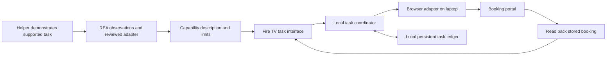

> 23 October upgrade: the current primary experience uses actual TfL public journey data, helper walking/change limits, native read-aloud, step-by-step review, saved routes, and an opt-in observation tool. The original fictional shuttle workflow below remains a separate booking lab. See `docs/UPGRADE_PLAN.md`, `docs/VALIDATION.md`, and `docs/USER_FINDINGS.md` for the current implementation and evidence.

# Handback TV

Planning snapshot, 20 October 2026. Implementation completed locally on 22 October; see README.md and docs/VALIDATION.md for the actual supported scope and measured results. This historical plan is not the validation report.

**A family member teaches a digital task. Someone else gets the ability to do it independently, using their television and remote.**

The opening line: “Dad should not need me to press Submit.”

## Constraints and decision

Confirmed by the builder: solo, substantial time available, an AWS account with no spending budget, and Azure student credits. Cash budget: zero. The builder subsequently confirmed no Fire TV stick is available; the implemented path uses the accepted Android TV emulator.

Choose Fire TV as the primary track, subject to a device smoke test. The device becomes the product's accessible interface. Do not add a second primary track before the Fire TV experience is finished.

The official deadline is **24 October 2026, 00:30 IST**. Target submission readiness by **23 October, 20:00 IST**. Fire TV first prize is $25,000 cash plus $15,000 AWS credits. Four criteria have equal weight: implementation, design, impact, and idea quality. A genuine friction log can receive up to a 10% bonus. The submission needs a working device/simulator demonstration, GitHub source, product feedback, and an English public video under three minutes. [Hackathon](https://amazonappdev2026.devpost.com/) · [Rules](https://amazonappdev2026.devpost.com/rules)

## Customer and first workflow

Initial customer hypothesis: an older adult who can operate a television remote but finds a service's small forms, navigation, and repeated data entry difficult. A trusted helper currently completes the task for them. Validate this hypothesis with one helper and, ideally, one person who experiences the difficulty.

The demonstration uses **booking a familiar community transport trip**. One supported portal, one passenger profile, permitted destinations, and a small set of trip choices. Avoid medical, financial, or emergency workflows.

Helper setup happens on a laptop. The helper configures a supported workflow from a reviewed template, using a demonstration to check the setup. They review the permitted passenger, destinations, fare limit, and verification rules. A reviewed capability description produces a simple Fire TV task card. The person then uses the remote to select a trip, review the exact terms, confirm, and read the verified result. In the demo, change a permitted destination or trip choice in helper setup and show the change on TV without editing code.

“Teach” means configuring one supported workflow from observed behavior and a reviewed template. It does not mean automatically understanding arbitrary websites. The first adapter will require engineering. Show that honestly.

The preferred target is a permissioned existing booking application on a deployment we control. Spend at most two hours finding and validating one. If unavailable, build a clearly identified reference portal and publish its behavior and limitations. A reference portal demonstrates the architecture; it does not validate compatibility with real transport providers. The adapter must operate its rendered interface, independently from the portal's implementation.

## What makes this worth building

The proposed contribution is the combination of family setup, a remote-first interface, limited task permissions, retained progress, and evidence of the actual outcome. Software adapts to a person's familiar device rather than requiring them to master the service's original interface.

Broad teach-and-replay automation already exists. [Workflow Use](https://github.com/browser-use/workflow-use) generates reusable browser workflows, and [Amazon has described interactive teaching for Alexa](https://www.amazon.science/blog/new-alexa-features-interactive-teaching-by-customers). Do not claim to have invented browser automation, teachable assistants, confirmations, or universal accessibility. No available search establishes what every participant is building or guarantees a winning idea.

Our differentiator must be visible in the product: a helper can hand back one useful ability, and the person can complete it independently from the sofa. Reliability is part of that independence.

This is outside the track's most obvious entertainment use cases. Its advantage is a distinctive use of the living-room device; its risk is weaker alignment with the highlighted content categories. Demonstrate why the TV and remote are essential to this customer, and validate the story before expanding scope.

## Exact MVP

Build:

- One installed Fire TV application, with clear focus, large text, predictable Back behavior, and no typing during the main task.
- One helper setup page for a supported booking workflow and reviewed limits.
- One browser adapter that selects, previews, submits, and reads a booking back from the portal.
- A persisted task state machine and a user-readable receipt.
- A controlled changed-fare scenario and an ambiguous-result scenario.
- After independent remote completion works, a second layout of the same portal to test a limited interface variation.

Defer arbitrary website learning, camera input, generalized agents, payments, messaging, Ring, Bee, native Alexa+ integration, an app marketplace, and multiple simultaneous households. Optional speech must not delay remote-only completion.

## The three-minute story

1. Show the original form and explain the dependency: Dad waits for someone else to book his trip.
2. Briefly show helper setup and the reviewed limits.
3. Show the actual Android TV emulator running the installed APK. Dad selects “My usual trip” with the remote.
4. Preview the exact day, time, destination, passenger, and fare.
5. Complete the trip, read the portal's stored booking back, and show its confirmation number on TV.
6. In a separate, clearly identified test request, change the fare. Show the earlier confirmation becoming invalid in approximately twenty seconds.
7. Put uncertain-response recovery and other technical scenarios in repository evidence rather than the main film.

The film should spend most of its time showing the person succeeding on the TV. Keep logs and architecture in supporting material. A laptop cursor controlling the main interface would undermine the central claim.

## REA's specific role

I read and applied the [requested reverse-engineer-anything skill](https://github.com/morluto/rea/blob/main/.agents/skills/reverse-engineer-anything/SKILL.md) and its [runtime observation guide](https://github.com/morluto/rea/blob/main/.agents/skills/reverse-engineer-anything/references/runtime-observation.md) to the investigation plan. No target application has yet been analyzed and no REA analysis engine or MCP registration has been installed in this session.

REA is an investigation tool, not the booking executor or an automatic accessibility guarantee. Use it on the selected deployed app or shipped assets when behavior cannot be established from the available source. Use ordinary source tools for normal repository analysis.

During the build:

1. Identify the exact target build, URL, and test account.
2. Capture the declared booking scenario. Depending on who operates it, use passive observation or REA's explicit scenario-capture workflow. Respect the distinction.
3. Inspect relevant rendered state, handlers, and shipped JavaScript only as needed to answer a concrete question.
4. Record preconditions, state transitions, submission behavior, and observable evidence of completion.
5. Separate observations, inferences, and unknowns. Keep evidence IDs, build identities, coverage limitations, and sanitized captures.
6. Implement the reviewed adapter with normal code; test its claims against the deployed target.

Useful questions: What signifies an available trip? Which fields define a booking? Does Submit create the booking before showing success? Can an existing booking be found reliably after a timeout? What changed between the two layouts?

Use the installed tool's actual supported schema/version. Repository-main documentation does not prove a particular package supports every feature. Prefer the CLI when it supports the needed operation without changing this chat's configuration. Timebox tooling setup to 45 minutes. If blocked, retain the gap explicitly and use normal browser evidence; do not pretend REA ran.

## Architecture and cost

**Base stack:** local Node.js/TypeScript coordinator, Playwright browser execution, SQLite persistence, and a small device client. Helper interface runs locally. The Fire TV and laptop use the same network with explicit pairing. No paid hosting, domain, AWS runtime, or paid browser service is required.

**Prototype dependency:** the paired laptop must remain powered, awake, and connected while the task runs. Nobody should need to operate it after setup. This is a prototype of independent interaction, not a standalone Fire TV deployment. Display a clear disconnected-service state and recover without resubmitting. A deployable always-available service is future work, not a completed capability.

**Device gate:** verify the precise model and OS before scaffolding. For Fire OS, start with a minimal Android/Kotlin TV shell and use native focusable controls; share backend types rather than forcing a desktop web interface onto the TV. For Vega OS, use its supported tooling and client approach. Do not assume an APK runs on Vega. Amazon documents both OS families in its [device matrix](https://developer.amazon.com/docs/fire-tv/fire-os-overview.html). Follow the applicable [device connection instructions](https://developer.amazon.com/docs/fire-tv/connecting-adb-to-device.html) and [TV interaction guidance](https://developer.amazon.com/docs/fire-tv/design-and-user-experience-guidelines.html).

**Optional AI:** Azure student credits may fund intent interpretation or drafting a capability description, only after verifying that an available model/service is covered by the current subscription. Credits are finite, not inherently free usage. Keep the subscription spending limit, do not upgrade to pay-as-you-go, and limit calls in the application. Budget alerts are not a hard spending cap. [Microsoft spending limits](https://learn.microsoft.com/en-us/azure/cost-management-billing/manage/spending-limit)

The core flow remains functional without a cloud model: structured choices, reviewed templates, and deterministic execution. AI may propose fields; code validates them. Do not describe a deterministic fallback as live model inference. Azure is optional, so unavailable credits or model quotas cannot block completion.

## Reliability contract

Persist states: draft → previewed → awaiting confirmation → submitting → verified, with explicit changed-terms, failed, and unknown-result states.

Bind confirmation to exact normalized terms: passenger, route, date, time, fare, currency, portal identity, workflow version, and an expiry. Re-read relevant terms before submission. A mismatch invalidates the earlier confirmation.

Prevent simultaneous local execution with an atomic transition and request identifier. After a timeout, inspect the portal's stored bookings before any further write. If the outcome cannot be established, show “We could not confirm whether your booking completed” and stop automatic resubmission.

Local locking and request identifiers do not create end-to-end exactly-once behavior in an arbitrary external portal. A strong guarantee needs a portal-supported idempotency key, atomic quote/version check, or equivalent capability. Document the target's actual support. Likewise, checking a fare just before clicking cannot eliminate every race if the portal provides no atomic validation.

A receipt shows what the portal confirms, when it was checked, and what remains unknown. Never claim success from an LLM sentence or the click alone. Do not promise a cancellation unless cancellation was observed and implemented.

Helper permissions require enforcement in the coordinator, not just hidden TV controls. A spoken name or demo persona selector is not authentication. Keep credentials on the laptop and use clearly identified test accounts for the prototype.

## Phased execution

Approximately **40 focused hours**, with contingency before the internal deadline. Dates below are IST.

| Phase | Date / effort | Deliverable | Exit condition |
|---|---|---|---|
| 0. Prove fit and access | Oct 20 / 3 h | Device smoke test, target choice, short customer conversation | Install a basic app and complete a remote interaction on actual hardware; select a reproducible portal |
| 1. Observe and specify | Oct 20 / 4 h | REA evidence ledger and reviewed workflow description | Every important adapter claim has evidence or an explicit unknown |
| 2. Complete one task | Oct 21 / 9 h | Coordinator, adapter, persistence, simple TV flow | Select → preview → confirm → stored booking read back → receipt works end to end |
| 3. Handle change and uncertainty | Oct 22 / 8 h | Confirmation invalidation, interrupted-task recovery, retry checks | Changed terms and ambiguous results behave as specified; no false success |
| 4. Make TV interaction excellent | Oct 22–23 / 7 h | Focus, typography, Back, errors, helper limits | Another person completes the flow with the remote without coaching |
| 5. Package evidence and submission | Oct 23 / 6 h | Clean setup, review build, demo, screenshots, feedback | Fresh-checkout run and full device rehearsal succeed |
| Contingency | Oct 23 / 3 h | Repair only | Ready by 20:00 IST; leave 4.5 h before official deadline |

If the device path cannot run within the initial gate, use the permitted Fire TV/Vega simulator path while diagnosing hardware. If the entire Fire TV toolchain remains a blocker, make an early decision about an Alexa+ MCP-client simulator entry during Phase 0. The organizers explicitly permit that route, but [real Alexa+ preview tools are unavailable to participants](https://amazonappdev2026.devpost.com/details/faqs). Avoid a late track switch or a second parallel build.

If universal teaching or Azure access slips, cut it. If one workflow is unstable, cut optional layout adaptation. Keep the real device flow, honest results, and submission package.

## Evidence to collect

Targets below are proposed acceptance checks, not measured results:

- Twenty representative valid input cases, recording success, failure, and latency.
- Changed fare and changed date invalidate the previous confirmation.
- Rapid repeated confirmation cannot start concurrent submissions.
- A response lost after submission is reconciled before another write.
- Unknown outcomes remain unknown to the user; no invented receipt.
- App closure preserves progress; restarting does not resubmit.
- Unsupported layouts stop with an explanation rather than guessing.
- Out-of-scope destination and expired permission are rejected by the backend.
- Remote-only navigation reaches every control, recovers from errors, and has predictable Back behavior.
- Changing a supported trip choice or permitted destination in helper setup changes the TV task card without a code edit.
- Launch and complete a trip from the installed TV app with nobody operating the laptop; disconnect the service and verify a clear, recoverable state.
- Another person attempts the workflow unaided. Report the participant's actual context; a teammate proxy is not a validated older-adult study.

Use a genuine customer conversation to identify the current steps and dependency. Do not invent time saved, adoption figures, or user quotes. Keep any comparison with manual completion small and explicitly described.

## Submission and optional mini challenge

Keep one repository with the complete runnable project, an appropriate open-source license, setup instructions, sample configuration, a resettable test target, and limitations. Record product feedback as development happens using FRICTION_LOG.md. Ensure the submission video shows the installed app on Fire TV and the portal's actual stored result.

Consider the Open Source mini challenge only after the core is stable: extract and publish an **additional reusable contract-and-verification kit**, with meaningful tests and documentation. A licensed main repository alone should not be assumed to satisfy the additional-project/contribution requirement. Do not add AWS services merely to chase an extra category under a zero-cash constraint.

Keep the project runnable through the judging period. Preserve a review build. No Git commit, tag, push, or public submission is permitted until the builder approves.

## Implementation status — 22 October

The local implementation now includes the installed Android TV APK, remote-first interface, helper configuration and pairing, browser adapter, independent fictional provider, persistence, transaction safeguards, and retained REA evidence. Workflow tests passed 21 cases, including twenty representative preview inputs; browser UI verification and an actual emulator D-pad booking also passed. See docs/VALIDATION.md and the machine-readable artifacts for exact evidence and limitations.

No real transport integration or customer study has been performed. No physical Fire TV hardware is available. No paid cloud service is required. No Git commits, tags, pushes, uploads, or final submission have been performed; these remain subject to the builder's approval.
