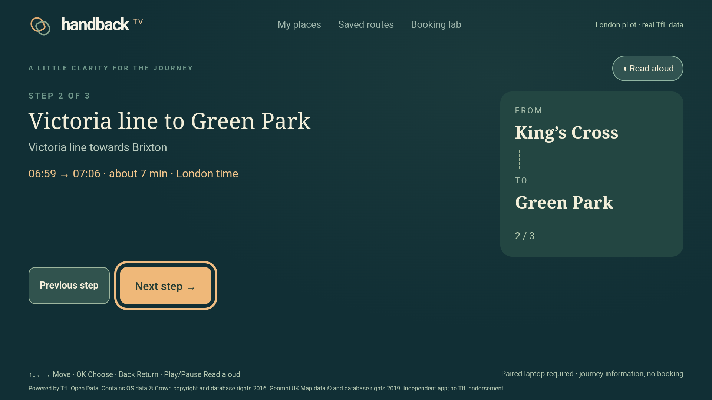

# Handback TV

**Give the everyday back.** A family member configures a supported task; someone else completes it independently using a television remote.

Handback is a working Android TV prototype with local and private Azure preview modes for the Amazon Developer Hackathon's Fire TV track. A helper configures familiar destinations and comfortable limits; the person plans a real London journey using the remote, reviews one instruction at a time, hears guidance aloud, and saves their choice.



## Two clearly separated paths

| Path | Integration | What it establishes |
|---|---|---|
| **Live journeys — primary experience** | Actual TfL Unified API, public London stations | Real journey planning, helper walking/change limits, step-free routing request, spoken guidance, local saved routes. No ticketing or reservation. |
| **Booking lab — transaction demonstration** | Fictional Willow Link website with an independent SQLite store | Exact-term confirmation, changed-fare protection, browser submission, stored-receipt verification, and conservative uncertain-outcome recovery. No live transport booking. |

## What runs

- **Installable Android TV app:** native Java launcher, D-pad/Select/Back and Play/Pause input, WebView, offline Android speech where available, and native MediaPlayer for the local speech fallback. No Google Play Services dependency in the app.
- **Real journey service:** allowlisted public station IDs, validated TfL responses, two matching options, total walking/change filters, London wall-clock times, source attribution, visible freshness, and saved-route rechecks. API requests are on demand, coalesced, cached, rate bounded, and timed out. Limits are never silently relaxed.
- **Helper dashboard:** one-use pairing, London origin/destination configuration, walking/change limits, access preference, reference booking permissions, activity evidence, and disclosed fault controls.
- **Read aloud:** Play/Pause or the on-screen control reads the current instruction and stops on request. An installed offline Android voice is preferred; this emulator uses built-in macOS speech synthesis and native local audio playback. The local fallback uses macOS Samantha; the hosted preview uses Linux eSpeak NG. Speech text is not sent to a paid speech API.
- **Observation tool:** opt-in local timing, Handback remote presses, read-aloud requests, assistance, and observer-reported outcomes. Builder self-tests, automated checks, and consenting participants remain distinct. No names, audio recording, or video recording are collected by the observation tool.
- **Booking coordinator and browser adapter:** SQLite checkpoints, exact confirmation, permissions at the write boundary, independent provider storage, atomic versioned quotes, idempotent request IDs, and receipt read-back through the rendered provider UI.

There are **no paid AI/speech APIs, external bookings, or payment flows**. TfL requests need internet access. The local mode requires the paired laptop to stay awake; the authorized Azure preview runs independently using Student credits. No physical Fire TV device or older-adult participant was available. The builder has not yet recorded a self-test; do not treat automated tests as user validation.

## Private hosted preview

Open <https://handback-tv-cb7fb9.koreacentral.cloudapp.azure.com/tv/journeys> and enter the private preview password. The helper dashboard is at `/helper`, and the separate booking lab is at `/tv`. The builder has a private `.tools/azure/ACCESS.md` file; credentials are excluded from this review package. Invited reviewers share owner access and test data, so use fictional details.

The cloud APK is [artifacts/handback-tv-cloud-debug.apk](artifacts/handback-tv-cloud-debug.apk). It starts at the Azure URL, coexists with the local APK, and needs the password before opening the remote interface. See [docs/AZURE_DEPLOYMENT.md](docs/AZURE_DEPLOYMENT.md) for architecture, costs, persistence, verification, and cleanup. The Student spending limit remains enabled.

## Quick start: laptop preview

Tested on Apple Silicon macOS with Node.js 22.14.0. Node 22.13+ includes the SQLite API used here; a maintained Node 24 release is also suitable. Node 22 prints an experimental SQLite warning.

```bash
npm ci
npx playwright install chromium
npm run build
npm start
```

Open:

- Helper dashboard: <http://127.0.0.1:4310/helper>
- Primary live journey TV preview: <http://127.0.0.1:4310/tv/journeys>
- Fictional booking TV lab: <http://127.0.0.1:4310/tv>
- Fictional reference portal: <http://127.0.0.1:4310/provider>

The helper dashboard shows a six-digit pairing code. Enter it in the TV preview and connect. Codes expire after ten minutes and work once. Generate a fresh code when pairing a different client. Only one TV token is active; pairing another TV replaces the previous token.

Arrow keys navigate the browser TV preview; Enter selects; Escape goes back. Press R to read aloud in the live journey interface. The browser preview is useful for development; the actual Android emulator is the submission demonstration platform.

## Run the actual Android TV application

A prebuilt debug APK is available at [artifacts/handback-tv-debug.apk](artifacts/handback-tv-debug.apk). It is a development build, not an Appstore release.

On the Mac used to develop this project, the Android SDK, emulator, and Gradle are installed under `.tools/`, and the `Handback_TV` virtual device is already created. With `npm start` running:

```bash
npm run android:run
```

On a fresh Apple Silicon Mac, install JDK 17 (or point `JAVA_HOME` at an existing JDK), then:

```bash
brew install openjdk@17
bash scripts/setup-android.sh
npm run android:run
```

The setup script downloads Google's official command-line tools and requests Android TV API 33 ARM64, Android platform 34, build tools 34, and the emulator. Review the package licenses when prompted. The included Gradle wrapper builds the APK. Android Studio is optional for this command-line path.

Alternatively, use Android Studio's Device Manager to create an **Android TV 1080p, API 33, ARM64** AVD named `Handback_TV`; set `ANDROID_HOME` to that SDK and `JAVA_HOME` to JDK 17. The automated bootstrap is tested on Apple Silicon macOS; other hosts should use their platform's matching TV image and Android Studio tooling.

The emulator accesses the laptop at `http://10.0.2.2:4310`. In local mode the server deliberately binds to `127.0.0.1` only. Hosted mode explicitly enables private-password access behind the HTTPS proxy; see the deployment notes. A physical Fire OS/Vega device was not available and has not been tested. The APK is an Android/Fire OS path, not a Vega package.

**Pairing on Android TV:** press the remote's Menu button, choose **Pair television**, and enter the code from the helper dashboard. The same dialog is available through the Android emulator's Menu input. For command-line testing, `adb shell input keyevent 82` opens the native Menu. Pairing is a one-time helper setup step; the booking flow needs no text entry.

### Build the APK again

```bash
npm run android:build
```

Output: `artifacts/handback-tv-debug.apk`. The source is in `android/`. The app uses the locally served interface; restart the local service after server code changes and reload the app after a web build.

## Try the real journey flow

1. Open **Helper → Live journeys**. Set King’s Cross as the starting station, choose familiar destinations, review maximum walking and changes, and save.
2. Pair the TV. The native app opens the live journey experience by default. No text entry is needed after setup.
3. Choose **Green Park**. The app requests real TfL data and displays routes that meet the configured limits. Upstream responses can take several seconds; the request times out after 25 seconds.
4. Review walking, changes, direction, and London-local times. Open the route and advance one step at a time.
5. Press **Play/Pause** to hear the current screen; press again to stop. On desktop, use **Read aloud** or R.
6. Save the reviewed route. This stores a reminder in the active service database (laptop or Azure); it does not buy a ticket. **Saved routes** requests fresh information rather than treating an old copy as current.
7. Set the walking limit to zero and request the route again. If no returned route fits, the TV says so and keeps the limit.

TfL data is cached for sixty seconds; no background TfL polling occurs. Fresh upstream calls are capped at twelve per minute. A temporary failure may return an explicitly stale copy for at most five minutes, with route selection/saving disabled. Fares, tickets, lift availability, and assistance are not guaranteed. Attribution and upstream terms are in [docs/INTEGRATION_SOURCES.md](docs/INTEGRATION_SOURCES.md).

## Run a truthful self-test

Open **Usability sessions**, select **Builder self-test**, agree to the observation, and start the timer. Use the task in [docs/USABILITY_PROTOCOL.md](docs/USABILITY_PROTOCOL.md), then record the actual result. Export downloads JSON; records remain in the active service database until deleted. No participant results have been collected; [docs/USER_FINDINGS.md](docs/USER_FINDINGS.md) remains empty of invented findings.

## Try the reference booking lab

1. On the helper dashboard, open **Supported task**. Choose a passenger name, pickup, permitted places, maximum fare, and expiry. Save.
2. Pair the TV. The task choices update without editing code.
3. On TV, select **Community Garden**, choose a day, and select **Review my trip**.
4. Review the exact passenger, pickup, destination, date, time, and fare. Nothing has been booked yet.
5. Select **Yes, book this trip**. Handback rechecks the quote, submits through the provider's browser UI, and reads the stored reservation back.
6. The receipt appears only when the provider's stored terms match the approved trip.
7. Reopen **My trips** to see the persisted result.

### Show a changed fare

Preview a trip on TV, then use **Demo controls → Raise fare by ₹20** on the helper dashboard. Confirm on TV. The old review is invalidated; a new review requires fresh confirmation. An increase above the helper's limit blocks the trip.

### Show a lost response

Before confirming, arm **The response goes missing**. The provider stores the reservation and returns a controlled error. Handback reads its history and reports the matching stored result without resubmitting.

For an uncertain outcome, also select **Make history unavailable**. The TV explicitly says the result is unknown, blocks another booking, and offers a read-only result check. Restore history and check again. It never invents a receipt or blindly retries a write.

**Reset demo scenario** clears only this prototype's fictional tasks/reservations and test switches. It keeps helper configuration and pairing. It refuses to run while a submission is active.

## Verification

```bash
npm run typecheck
npm test
npm run test:ui
npm run test:journey-ui
# Actual public API calls, separate from deterministic tests:
npm run test:live
# With the service and emulator running:
npm run test:emulator
npm run test:live-emulator
```

- Workflow tests use real Chromium sessions against a resettable, independently stored reference provider. They cover successful receipts, changed terms, spending restrictions, repeated/concurrent confirmation, lost responses, unavailable history, previous drafts, permission changes, unsupported layouts, and interrupted-process recovery.
- Twenty representative destination/date cases are measured in `artifacts/input-evaluation.json`.
- UI verification exercises pairing, D-pad focus, complete booking, persistence, helper changes, changed fares, and viewport fit. It generates screenshots.
- Emulator verification runs the installed APK, exercises its real native Menu and pairing dialog, then drives the booking workflow with Android D-pad input events. Its report includes the resulting stored receipt.

See [docs/VALIDATION.md](docs/VALIDATION.md) and the machine-readable reports in `artifacts/`. No customer interviews or older-adult usability study have been conducted; automated functional success is not proof of real-world accessibility or adoption.

## REA evidence

The requested `reverse-engineer-anything` skill informed the investigation and evidence ledger. REA 6.7.0 also executed a declared browser scenario against the rendered reference portal. The scenario clicks **Review trip**, waits for the current quote, and captures DOM, accessibility, and URL evidence. It does not submit a booking.

- Scenario: `artifacts/rea/quote-scenario.json`
- Full canonical evidence: `artifacts/rea/quote-evidence.json`
- Interpretation and limits: [docs/REA_FINDINGS.md](docs/REA_FINDINGS.md)

The adapter was engineered from a reviewed workflow; we do not claim that REA autonomously created it or that the prototype learns arbitrary websites. This is behavior verification of our own reference application, not reverse engineering of an unauthorized third-party product.

To repeat the optional REA capture, use Node 24 (REA has stricter runtime requirements than the core application):

```bash
npx tsx scripts/capture-rea.ts
npx -y rea-agents@6.7.0 capture-browser-scenario artifacts/rea/quote-scenario.json --format json > artifacts/rea/quote-evidence.json
```

## Security and guarantee boundaries

This is a trusted-household prototype. Local helper bootstrap is available on the laptop loopback interface. Cloud mode requires a private password before any bootstrap or data access, with shared owner/reviewer privileges rather than per-person accounts. TV tokens and databases stay in the active service data directory; the local `.data/` and cloud provisioning state are ignored. Pairing is one-use and rate-limited. Requests reject unrecognized hosts/origins. Runtime JSON and web builds are not cached. The app allows cleartext only for the explicitly declared local emulator addresses; the cloud build also permits HTTPS Azure public DNS addresses. It does not accept arbitrary remote service URLs.

Confirmation is bound to server-stored exact terms and a two-minute review expiry. Helper changes are blocked while a write is in flight; permissions and expiry are checked again at the submit boundary. A new trip cannot bypass an unresolved write. A restarted in-flight task becomes unknown until checked.

The reference provider supports atomic version validation and request idempotency. **These guarantees do not automatically transfer to an arbitrary website.** A new provider requires an authorized adapter and an explicit assessment of its quote, authentication, idempotency, and read-back semantics. There is no general promise of exactly-once behavior or automatic cancellation for third-party services.

## Submission materials and review

- [docs/DEVPOST_DRAFT.md](docs/DEVPOST_DRAFT.md): honest, editable project story and technology list.
- [docs/PRODUCT_FEEDBACK.md](docs/PRODUCT_FEEDBACK.md): actual tools and development friction.
- [docs/REVIEW_GUIDE.md](docs/REVIEW_GUIDE.md): suggested review order and publication boundaries.
- [DEMO_SCRIPT.md](DEMO_SCRIPT.md): recording plan; updated implementation notes are in `docs/DEMO_RECORDING.md`.
- `artifacts/screenshots/`: real interface and emulator captures.
- `artifacts/handback-tv-debug.apk`: installable test package.
- `artifacts/handback-tv-judges-demo.mp4`: final landscape demo, about 2:13, with synthetic narration, quieter credited instrumental music, and actual emulator footage. See `docs/DEMO_RECORDING.md` for sources, captions, and the retained earlier draft.
- `artifacts/handback-tv-review.zip`: source, APK, demo, documentation, and verification reports, excluding local databases and downloaded SDKs.

The private Azure preview is deployed with the builder's authorization. No Git repository, commits, remote pushes, public video upload, or final Devpost submission have been created. Those steps remain subject to the builder's review and approval.

## License

Original project source and artwork: MIT; see [LICENSE](LICENSE). Package dependencies and Android/Gradle tooling retain their own licenses. Google/Android tooling and downloaded browsers are not part of the source distribution. See [THIRD_PARTY_NOTICES.md](THIRD_PARTY_NOTICES.md).
